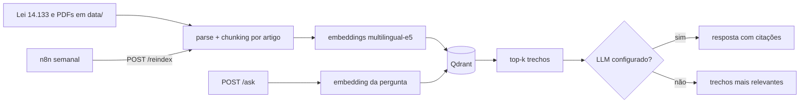

# rag-licitacoes

Perguntas e respostas sobre a Lei 14.133/2021 (Nova Lei de Licitações e Contratos) com citação do artigo de onde saiu cada resposta.

Comecei esse projeto por causa de um problema que já enfrentei em trabalho com licitações públicas: o texto da lei é grande, cheio de remissões, e uma resposta sem a fonte não serve para quem precisa conferir. Aqui toda resposta devolve os trechos usados, com artigo e capítulo.

## Como funciona



- **ingest/**: lê HTML, TXT ou PDF, separa por artigo e indexa no Qdrant.
- **api/**: FastAPI com `/ask`, `/search`, `/health` e `/reindex`.
- **n8n/workflow.json**: verifica toda semana se o texto da lei mudou no Planalto e, se mudou, chama `/reindex`.
- **eval/**: 30 perguntas com o artigo esperado e um script que mede a recuperação.

## Rodando

Precisa de Docker. Na primeira vez baixa o modelo de embeddings (~470 MB) e a lei.

```bash
git clone https://github.com/<seu-usuario>/rag-licitacoes
cd rag-licitacoes
cp .env.example .env     # opcional, só se for usar LLM
docker compose up --build
```

Quando o `ingest` terminar, a API sobe em `http://localhost:8000` (docs interativas em `/docs`).

```bash
curl -s localhost:8000/ask -H 'Content-Type: application/json' \
  -d '{"pergunta": "Quais sanções podem ser aplicadas ao licitante que comete infração?"}'
```

A resposta tem este formato:

```json
{
  "resposta": "...",
  "modo": "llm",
  "fontes": [
    {
      "rotulo": "Art. 156",
      "artigo": "156",
      "contexto": "TÍTULO IV > CAPÍTULO I - ...",
      "trecho": "Art. 156. Serão aplicadas ao responsável pelas infrações...",
      "score": 0.87,
      "origem": "Lei 14.133/2021"
    }
  ]
}
```

### Com ou sem LLM

Sem `LLM_API_KEY` a API funciona em **modo extrativo**: devolve os trechos mais próximos da pergunta e nada mais. Com a chave preenchida, qualquer endpoint compatível com a API da OpenAI serve (OpenAI, Ollama, vLLM, OpenRouter). Os exemplos estão no `.env.example`.

O prompt obriga o modelo a responder só com os trechos recuperados e a citar `[Art. N]`. Se o LLM falhar, a API volta para o modo extrativo em vez de dar erro.

### Indexar outros documentos

Copie PDFs de editais para `data/` e rode `make reindex`. Documentos sem estrutura de artigos são divididos por parágrafos.

### n8n (opcional)

```bash
docker compose --profile automacao up
```

Abra `http://localhost:5678`, importe `n8n/workflow.json` e ative o workflow. Ele compara o hash da página da lei com a execução anterior e só reindexa quando há diferença. O token vem da variável `ADMIN_TOKEN`.

## Avaliação

`eval/run_eval.py` pergunta cada item de `eval/perguntas.jsonl` ao endpoint `/search` e confere se o artigo esperado aparece entre os 5 primeiros trechos. Mede só a recuperação, que é a parte determinística. A qualidade do texto gerado depende do LLM escolhido e não entra aqui.

```bash
python eval/run_eval.py     # grava eval/resultados.md
```

Resultado com `intfloat/multilingual-e5-small`:

| métrica | valor |
|---|---|
| hit@1 | _rodar e preencher_ |
| hit@3 | _rodar e preencher_ |
| hit@5 | _rodar e preencher_ |
| MRR   | _rodar e preencher_ |

As perguntas não citam número de artigo de propósito, para não medir a busca por palavra-chave.

## Decisões e trade-offs

**Chunking por artigo, não por tamanho fixo.** Uma lei é citada por artigo, então o artigo é a unidade natural de resposta. Chunks de tamanho fixo cortam incisos no meio e misturam artigos. Artigos grandes, como o 6º com suas definições, passam de 1800 caracteres e são divididos em blocos que repetem o caput. O capítulo e o título entram no texto que vira embedding, o que ajuda em perguntas genéricas.

**Texto revogado é descartado.** O HTML do Planalto marca dispositivos revogados com texto tachado. O parser ignora o que está tachado.

**Embedding local.** Usei `multilingual-e5-small` por rodar em CPU, ser gratuito e funcionar bem em português. O modelo `base` melhora a recuperação, mas dobra o tempo de indexação. Dá para trocar com `EMBED_MODEL`.

**Citação de artigo na pergunta.** Embeddings são ruins para números: "art. 75" tende a trazer qualquer coisa parecida. Se a pergunta cita um artigo, os chunks dele vêm primeiro, via filtro no Qdrant, e a busca semântica completa o resto.

**Sem reranker e sem busca híbrida.** Mantive simples. Se o `hit@1` ficar baixo, o próximo passo é BM25 junto com a busca vetorial e um reranker cross-encoder.

**Reindexação recria a coleção.** Para uma única lei é rápido e simples, mas a API devolve 503 durante alguns segundos. Com mais documentos eu trocaria por alias de coleção.

## Limitações

- A lei é atualizada por decretos (os valores de dispensa, por exemplo, são reajustados). A base reflete o texto da lei, não os decretos.
- A resposta não é parecer jurídico.
- Editais em PDF escaneado precisam de OCR antes. O `pypdf` só lê PDF com texto.
- O chunking genérico de editais é básico. Editais costumam ter numeração própria (5.1, 5.2) que daria para aproveitar.

## Desenvolvimento

```bash
python -m venv .venv && source .venv/bin/activate
pip install -r requirements-dev.txt
docker compose up qdrant -d
QDRANT_URL=http://localhost:6333 python -m ingest.main
QDRANT_URL=http://localhost:6333 uvicorn api.main:app --reload
make test
```

Os testes (`tests/`) cobrem o parser e o chunking: texto tachado, contexto de capítulo, divisão de artigo longo e fallback para documentos sem artigos.

## Estrutura

```
ingest/    leitura, chunking, embeddings e indexação
api/       FastAPI: busca, geração e reindexação
eval/      perguntas de teste e script de métricas
n8n/       workflow de atualização semanal
tests/     testes do parser
data/      documentos públicos (fora do git)
```

## Licença

MIT
